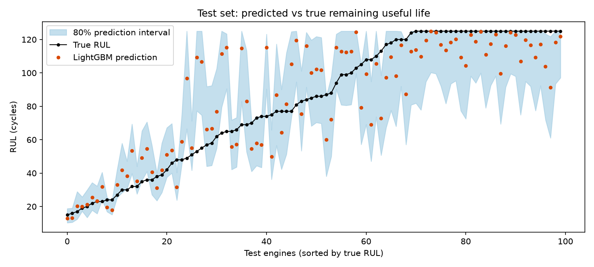
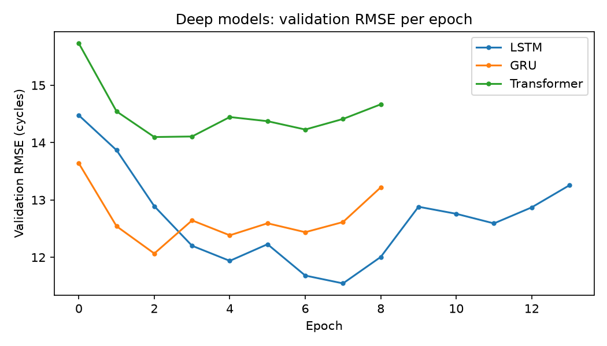
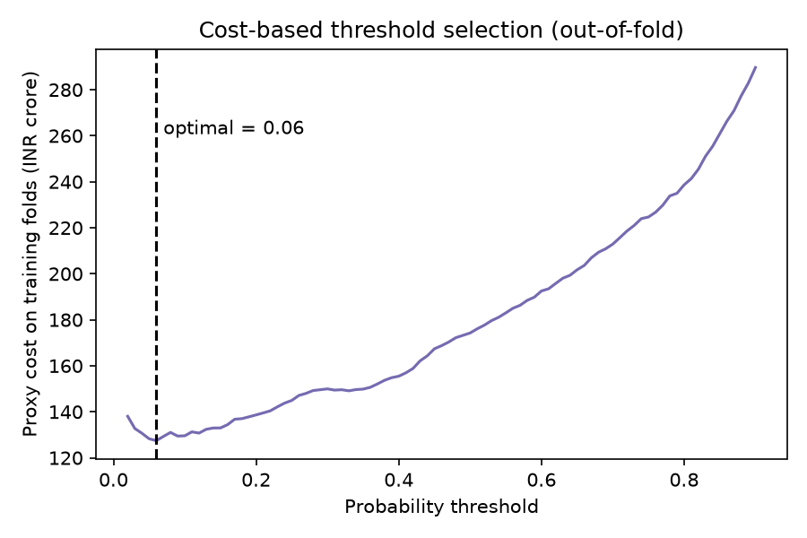
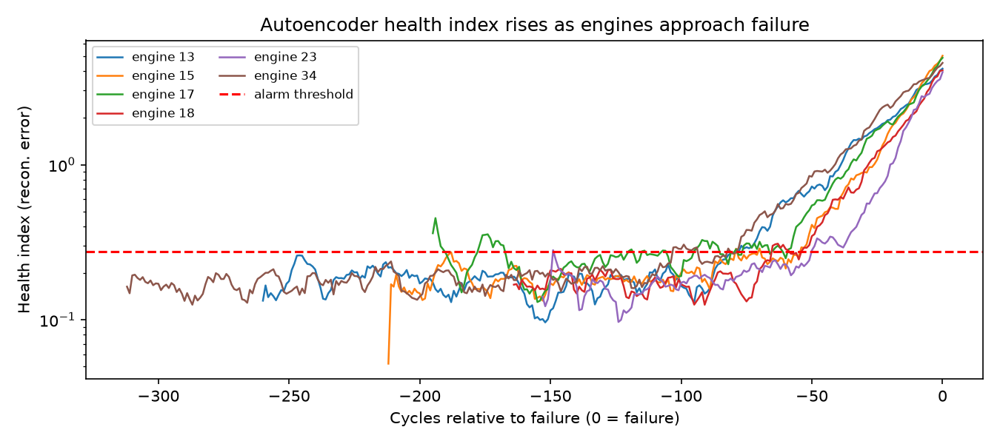
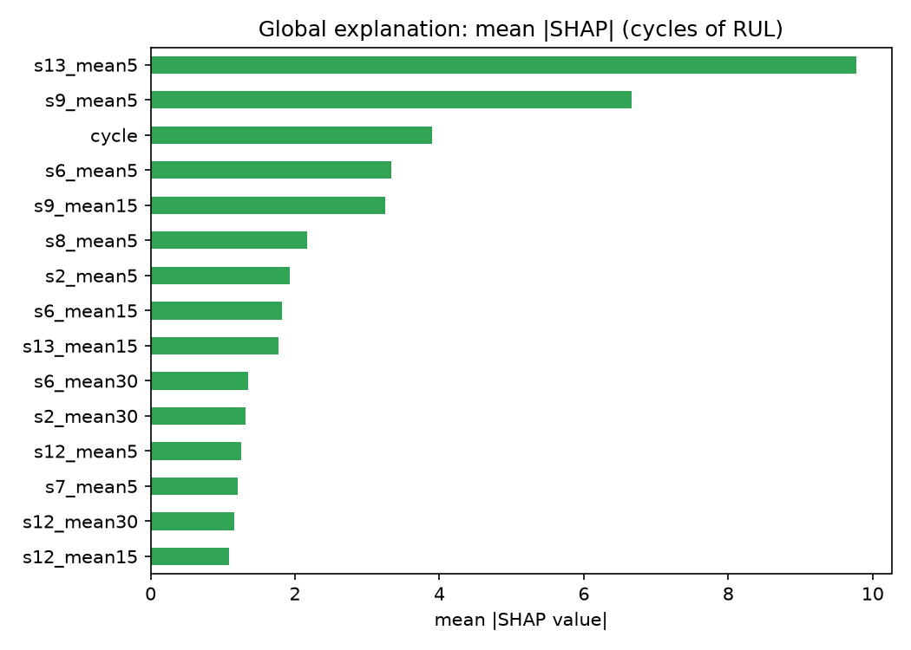
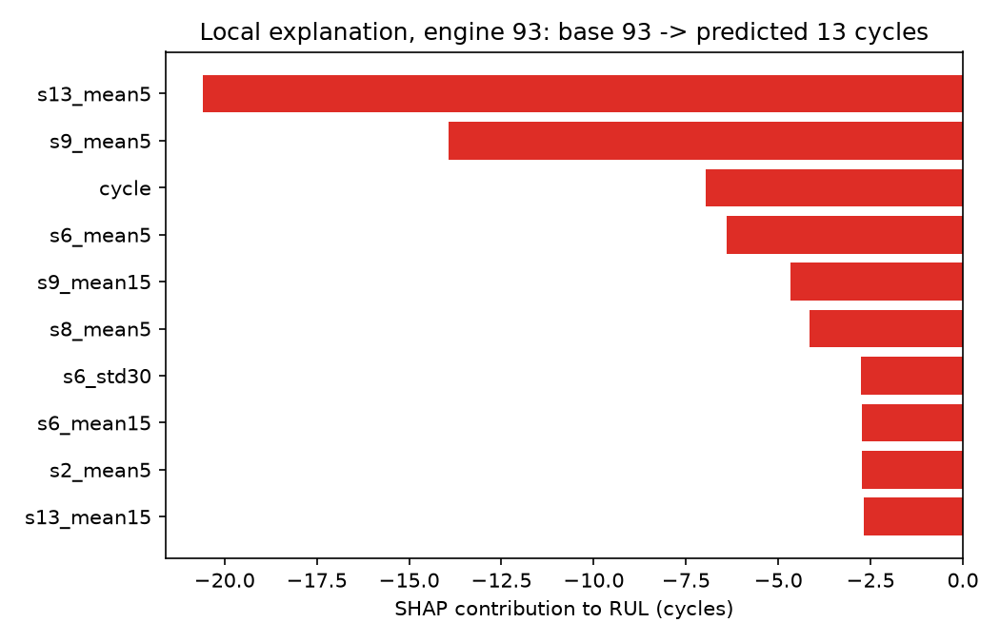
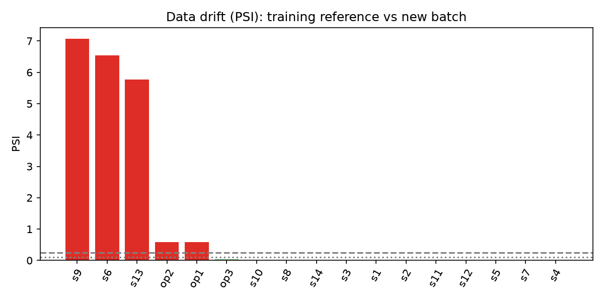
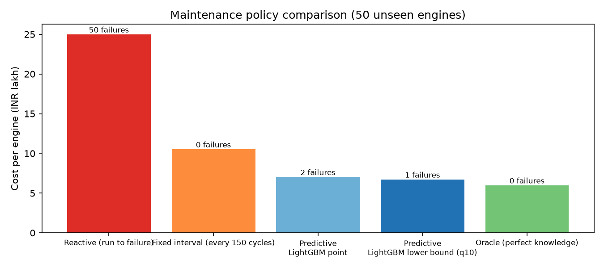

\newpage

# Executive Summary

This project builds a complete predictive maintenance system for a fleet of aircraft
turbofan engines. Using sensor readings recorded every flight cycle, it predicts each
engine's **Remaining Useful Life (RUL)**: the number of cycles left before failure. It
then turns those predictions into maintenance decisions.

The project goes well beyond training a single model. It covers the full predictive
analytics lifecycle: problem framing, feature engineering for multi-regime sensor data,
leakage-safe validation, classical and deep learning models, prediction intervals,
cost-based decision thresholds, unsupervised health monitoring, explainability, drift
monitoring, a REST API and a business-impact simulation.

**Headline results (on engines the models never saw):**

| Result | Value |
|---|---|
| Best RUL model on the 100-engine test set | GRU, RMSE 17.6 cycles (mean-RUL baseline: 39.1) |
| LightGBM RMSE across all 16,379 test rows | 12.7 cycles |
| Failure-within-30-cycles classifier | Recall 97.3% (110 of 113 imminent failures caught), ROC-AUC 0.999 |
| Autoencoder early warning (no labels needed) | Alarm raised a median of 68 cycles before failure |
| Drift monitor | Correctly flagged the 3 drifted sensors and the route-mix change; no false alarms on clean data |
| Business impact (50 unseen engines) | Predictive policy costs **INR 6.7 lakh per engine** vs 10.5 lakh (fixed interval) and 25 lakh (run to failure): **36% saving vs fixed-interval maintenance** |

# 1. Problem Statement and Business Context

## 1.1 The business problem

Airlines and industrial operators maintain engines in one of three ways:

- **Reactive:** run until something breaks. Unplanned failures are extremely expensive: emergency repair, grounded aircraft, cancelled flights and safety risk.
- **Preventive (fixed interval):** service every engine after a fixed number of cycles. This is safe, but engines are serviced long before they need it, wasting useful life and money.
- **Predictive:** service each engine when its own condition shows it is approaching failure. This is the goal of this project.

## 1.2 The analytics questions

| Business question | Analytics formulation | Problem type |
|---|---|---|
| How long can this engine keep flying? | Predict RUL in cycles | Regression |
| How sure are we? | 80% prediction interval around the RUL | Uncertainty quantification |
| Must we act now? | P(failure within 30 cycles) | Binary classification |
| Is this engine behaving abnormally, even with no failure history? | Reconstruction error from a model of healthy behaviour | Unsupervised anomaly detection |
| Why did the model say that? | Feature contributions per prediction | Explainability |
| Can we still trust the model next month? | Compare new data with training data | Drift monitoring |
| Is it worth it? | Cost of each maintenance policy | Decision simulation |

## 1.3 Success criteria

- **Model:** RMSE clearly better than the baseline; recall of at least 95% for imminent failures.
- **Business:** lower total maintenance cost than the fixed-interval policy without a material increase in unplanned failures.

# 2. Dataset

## 2.1 Source

The project uses a **fleet simulator** (`src/data_generator.py`) that writes data in exactly the
same format as NASA's C-MAPSS turbofan benchmark: engine id, cycle number, 3 operating
settings and sensor channels. Using a simulator means the project runs offline and the
ground truth is fully known. The README explains how to switch to the real C-MAPSS FD002 or
FD004 files without changing any downstream code.

## 2.2 How the data behaves

- Each engine has a different life (150–360 cycles), a different amount of initial wear and a different degradation speed.
- Hidden degradation grows **exponentially**: slow at first, then accelerating towards failure.
- Every cycle, the engine flies in one of **6 operating regimes** (altitude, Mach, throttle). The regime shifts sensor values far more than degradation does. This is the central data challenge.
- 10 of the 14 sensors respond to degradation; **4 are pure noise**.
- Each engine has its own small sensor bias, as real engines do.

## 2.3 Data files

| File | Engines | Rows | Purpose |
|---|---|---|---|
| `train.csv` | 200 | 49,999 | Run-to-failure histories for training |
| `test.csv` + `test_rul.csv` | 100 | 16,379 | Histories cut at 30–95% of life; true RUL kept as an answer key |
| `drift_batch.csv` | 60 | 9,832 | Later batch with sensor recalibration drift and more high-altitude routes |
| `sim_fleet.csv` | 100 | 25,714 | Full histories used only for the business simulation |

## 2.4 Target definition

RUL at cycle $t$ = (failure cycle) − $t$. Following standard practice, RUL is **capped at 125
cycles** (a piecewise-linear target). Early in life there is no measurable degradation, so
asking the model to distinguish "250 cycles left" from "200 cycles left" only adds noise. A
prediction of 125 means *"healthy, no degradation detected"*.

# 3. Solution Architecture

| Stage | Script | Output |
|---|---|---|
| 1. Data | `data_generator.py` | Train, test, drift and simulation CSVs |
| 2. Features | `features.py` | `FeaturePipeline`: regimes, normalisation, sensor selection, 81 temporal features |
| 3. Classical ML | `train_ml.py` | Baselines, LightGBM, intervals, failure classifier, deployable model bundle |
| 4. Deep learning | `train_dl.py` | LSTM, GRU, Transformer and weighted ensemble |
| 5. Health monitoring | `anomaly.py` | Autoencoder health index and lead-time analysis |
| 6. Explain and monitor | `explain_monitor.py` | SHAP explanations, PSI drift report, performance under drift |
| 7. Business impact | `maintenance_policy.py` | Cost of 5 maintenance policies |
| 8. Serving | `api/app.py`, `Dockerfile` | REST API returning RUL, interval, risk, action and drivers |

`python run_all.py` runs stages 1–7 in about 4–5 minutes on a 2-core CPU.

# 4. Feature Engineering

## 4.1 Operating-regime detection (unsupervised)

KMeans with 6 clusters on the standardised operating settings recovers the flight regime of every
cycle. This is a practical use of clustering inside a supervised pipeline.

## 4.2 Regime-wise normalisation

Each sensor is z-scored using the mean and standard deviation **of its own regime**, learned from
training data only. Without this step, the regime effect hides the degradation signal; with it,
the slow upward or downward drift caused by wear becomes visible.

## 4.3 Sensor selection

The Spearman correlation of each normalised sensor with RUL was computed on training data:

| Sensors | Abs. correlation with RUL | Decision |
|---|---|---|
| s6, s13, s9, s2, s8, s12, s7, s3, s4, s11 | 0.58 – 0.76 | Kept |
| s10, s14, s1, s5 | below 0.02 | Dropped (noise) |

The selection recovered exactly the 4 noise sensors built into the simulator.

## 4.4 Temporal features (per engine)

For each of the 10 kept sensors: rolling mean and rolling standard deviation over 5, 15 and 30
cycles, the rolling **slope** over 15 cycles (local degradation trend), and an exponentially
weighted mean. With the cycle count, this gives **81 features**.

## 4.5 Leakage safeguards

- All statistics (regime model, regime means/stds, sensor selection) are learned from training data only and stored in one `FeaturePipeline` object.
- Rolling features look **backwards only**.
- Cross-validation splits by **engine**, never by row, so cycles of one engine never appear in both training and validation.
- The **same pipeline object** is used in training, testing and the API, which prevents training/serving skew.

# 5. Modelling

## 5.1 Evaluation design

- **Main test:** predict RUL at the **last observed cycle** of each of the 100 test engines. This mirrors the real question: "given everything we have seen so far, how long is left?"
- **Metrics:** RMSE, MAE and the **NASA asymmetric score**, which penalises *late* predictions (over-estimating life) more than early ones, because over-estimating life can cause an in-service failure.

## 5.2 Regression results (100 test engines, last cycle)

| Model | RMSE | MAE | NASA score (lower is better) |
|---|---|---|---|
| Baseline: mean RUL | 39.11 | 33.97 | 21,564 |
| Ridge regression (81 features) | 18.21 | 14.10 | 769 |
| LightGBM (81 features) | 19.60 | 14.68 | 1,302 |
| LSTM (2 layers, 30-cycle window) | 18.50 | 13.54 | 954 |
| **GRU (2 layers, 30-cycle window)** | **17.62** | **12.70** | 888 |
| Transformer encoder (2 layers, 4 heads) | 19.17 | 13.13 | 1,463 |
| Ensemble (0.3 LightGBM + 0.7 LSTM) | 18.25 | 13.64 | 856 |

Additional views of LightGBM performance:

| Evaluation | RMSE | MAE |
|---|---|---|
| 5-fold grouped cross-validation, all training cycles | 13.34 | 8.58 |
| All 16,379 test rows | 12.71 | 8.11 |

{width=95%}

**Interpretation:**

- Every model cuts the baseline error by more than half.
- All good models land in a narrow band (17.6–19.6 RMSE). On 100 engines, differences of 1–2 cycles are within sampling noise, so **no single model is clearly best**.
- **Ridge is competitive with LightGBM.** Once the features are engineered well, the relationship is close to linear. This is an important lesson: good features often matter more than a complex model.
- Errors are small when the engine is close to failure (where accuracy matters most) and larger in mid-life, where degradation has only just begun.

## 5.3 Deep learning models

The LSTM, GRU and Transformer read the last 30 cycles of the 10 normalised sensors directly and
learn their own temporal features. Training used AdamW, gradient clipping, a learning-rate
scheduler and early stopping on 20% of training engines held out for validation.

| Model | Parameters | Epochs (early stopped) | Training time (CPU) | Validation RMSE |
|---|---|---|---|---|
| LSTM | 54,849 | 14 | 50 s | 11.54 |
| GRU | 41,665 | 9 | 45 s | 12.09 |
| Transformer | 71,681 | 9 | 108 s | 14.07 |

{width=70%}

The GRU matched the LSTM with 24% fewer parameters and less training time. The Transformer was
the slowest and least accurate here: with short 30-step windows and only 200 engines, its
advantages (long-range attention, parallelism at scale) do not pay off. This is a realistic
finding worth discussing with learners.

**Ensemble:** Weights were chosen on the validation engines only (LightGBM 0.3, LSTM 0.7, Ridge
0.0). The ensemble gave the second-best NASA score, though not the lowest RMSE on this test set.

## 5.4 Prediction intervals

An 80% interval is produced by adding residual quantiles, learned from out-of-fold predictions
and binned by predicted RUL, to each prediction (`src/intervals.py`, a split-conformal approach).
Gradient-boosted quantile regression was tried first and rejected: because the target is capped,
the upper-quantile model stuck at 125 for almost every engine.

| Measure | Value |
|---|---|
| Target coverage | 80% |
| Coverage on all 16,379 test rows | 87.1% |
| Coverage at the last cycle (100 engines) | 72.0% |
| Mean interval width | 36.2 cycles |

Coverage across all test rows is slightly conservative. At the last cycle of each engine it is
below target. That point is mid-life on average, where uncertainty is highest, and 100 engines is
a small sample. Mid-life calibration is listed as an improvement in Section 10.

## 5.5 Failure-within-30-cycles classifier

A LightGBM classifier predicts whether the engine will fail within 30 cycles. The decision
threshold was **not** left at 0.5. It was chosen to minimise expected cost on out-of-fold
predictions, where a missed failure (INR 25 lakh) costs about 4 times as much as an unnecessary
shop visit (INR 6 lakh).

{width=60%}

Test results (all 16,379 test rows; 113 rows are within 30 cycles of failure):

| Metric | Value |
|---|---|
| Cost-optimal threshold | 0.06 |
| Recall | 97.3% (110 of 113) |
| Precision | 51.6% |
| ROC-AUC / PR-AUC | 0.999 / 0.843 |
| Confusion matrix | TP 110, FP 103, FN 3, TN 16,163 |

The low threshold deliberately trades precision for recall: about half the alerts are early,
but almost no imminent failure is missed. Because 99% of rows are negatives, PR-AUC is the more
honest summary than ROC-AUC.

# 6. Unsupervised Health Monitoring

An autoencoder (10 → 16 → 3 → 16 → 10) was trained **only on healthy cycles** (RUL > 150). Its
reconstruction error, smoothed over 10 cycles, acts as a **health index** that needs no failure
labels. This is valuable for new equipment that has no failure history yet.

{width=90%}

| Result (40 held-out engines) | Value |
|---|---|
| Engines that raised an alarm before failure | 40 of 40 |
| Median warning lead time | 68.5 cycles |
| 10th-percentile lead time | 36.8 cycles |
| Alarms while clearly healthy (RUL > 150) | 3 engines |

# 7. Explainability

SHAP values explain the LightGBM model globally and for each prediction.

{width=65%}

Short-window means of the strongest degrading sensors (s13, s9, s6) dominate. The `cycle`
feature ranks third. This deserves scrutiny: it can act as a proxy for the age of a fleet and may
not transfer to engines with different usage. Removing it and comparing results is one of the
suggested learner extensions.

{width=65%}

For engine 93 (true RUL 15), the model starts from the average prediction of 93 cycles. The
recent values of s13 and s9 pull it down by about 34 cycles, giving a final prediction of 13
cycles. A maintenance engineer can check those two sensors directly. The API returns the top 3
drivers with every prediction.

# 8. Monitoring and Drift

A model that was accurate at launch degrades when the data changes. The drift batch simulates two
realistic changes: a **recalibration of 3 sensors** (s6, s9, s13 now read "healthier" than
reality) and a **shift towards high-altitude routes**.

**Monitoring design:** The Population Stability Index (PSI) is computed on regime-normalised,
early-life sensor values and on the raw operating settings. Normalising first matters. A first
version that compared raw sensors flagged all 14 as drifted, simply because the route mix
changed. That is an alarm-fatigue problem.

{width=85%}

| Check | Result |
|---|---|
| Drifted features flagged (PSI > 0.25) | s9, s6, s13 (PSI 5.8–7.1) and op1, op2 (route mix) |
| Maximum PSI on the clean test set | 0.015 (no false alarms) |
| LightGBM RMSE, clean test set | 19.6 |
| LightGBM RMSE, drifted batch | **32.2** (+64%) |

The drift monitor detects the problem before any failure labels arrive. In production, this
would trigger sensor validation and model retraining.

# 9. Business Impact

Five policies were simulated on 50 engines the models never saw. Safety margins were tuned on a
separate group of 50 engines.

| Policy | Cost per engine (INR) | Unplanned failures | Saving vs reactive | Saving vs fixed interval |
|---|---|---|---|---|
| Reactive (run to failure) | 25,00,000 | 50 | – | – |
| Fixed interval (every 150 cycles) | 10,53,600 | 0 | 57.9% | – |
| Predictive: LightGBM point estimate | 7,04,800 | 2 | 71.8% | 33.1% |
| **Predictive: interval lower bound** | **6,72,560** | **1** | **73.1%** | **36.2%** |
| Oracle (perfect knowledge) | 6,00,000 | 0 | 76.0% | 43.1% |

{width=90%}

The best fixed interval must be as short as the shortest engine life (150 cycles), so it throws
away about 100 cycles of useful life per engine. The predictive policy recovers most of that
value and reaches **84% of the maximum possible saving** (the oracle). Using the **lower bound**
of the interval rather than the point estimate halved the number of unplanned failures and
lowered cost. This is a direct, monetary demonstration of why uncertainty estimates matter.

*Cost assumptions (in `config.py`, easy to change): unplanned failure INR 25 lakh, planned shop
visit INR 6 lakh, lost useful life INR 4,000 per cycle, 15-cycle scheduling lead time.*

# 10. Deployment

## 10.1 REST API

`api/app.py` (FastAPI) loads the single model bundle (feature pipeline, regressor, intervals,
classifier and threshold) and exposes:

| Endpoint | Purpose |
|---|---|
| `GET /health` | Liveness check |
| `GET /model-info` | Selected sensors, feature count, decision threshold |
| `POST /predict` | Score one engine's sensor history |

Example response for test engine 93 (true RUL 15):

```json
{
  "engine_id": 93, "last_cycle": 136,
  "predicted_rul": 13.0, "rul_interval_80pct": [10.3, 18.8],
  "failure_probability_30_cycles": 0.998,
  "risk_level": "HIGH", "recommended_action": "Schedule shop visit now",
  "top_drivers": [{"feature": "s13_mean5", "effect_on_rul_cycles": -20.57},
                  {"feature": "s9_mean5",  "effect_on_rul_cycles": -13.92},
                  {"feature": "cycle",     "effect_on_rul_cycles": -6.96}]
}
```

Input is validated with Pydantic (for example, duplicate cycle numbers are rejected with HTTP 422).
Four automated tests (`tests/test_api.py`) cover the main behaviours and pass.

## 10.2 Containerisation

The `Dockerfile` packages only what serving needs (no PyTorch), keeping the image small.

## 10.3 Production checklist

- Batch-score the fleet nightly; call the API in real time after each flight.
- Run the PSI monitor weekly; alert above 0.25.
- Track realised RUL errors as engines are serviced; retrain when drift or error thresholds are crossed.
- Version every model bundle and keep the previous one for rollback.

## 10.4 Limitations

- The data is simulated. Real fleets have maintenance events, sensor faults, missing data and censored histories.
- The test set is small (100 engines), so differences of 1–2 RMSE between models are not significant.
- Interval coverage at mid-life is below target (Section 5.4).
- The `cycle` feature may encode fleet-specific usage patterns.

# 11. How to Run

```bash
pip install -r requirements.txt
python run_all.py                    # all stages, about 5 minutes on a CPU
python -m pytest -q                  # tests
uvicorn api.app:app --reload         # API docs at http://127.0.0.1:8000/docs
```

All metrics are written to `outputs/*.json` and `outputs/*.csv`, and all figures to `outputs/figures/`.
Results are reproducible (fixed random seeds).

\newpage

# 12. Trainer Guide: Running This as a Capstone

## 12.1 Learning outcomes

Learners who complete this project will be able to:

1. Frame a business problem as regression, classification and anomaly-detection tasks.
2. Engineer features for multi-regime time series without leakage.
3. Validate models with grouped and time-aware splits.
4. Compare classical ML and deep sequence models fairly.
5. Quantify uncertainty and choose cost-based decision thresholds.
6. Explain predictions with SHAP and monitor drift with PSI.
7. Deploy a model as a tested REST API.
8. Translate model performance into business value.

## 12.2 Suggested milestones (2 weeks, teams of 3–4)

| Day | Milestone | Deliverable |
|---|---|---|
| 1–2 | Problem framing, EDA, regime discovery | EDA notebook; one-page problem statement |
| 3–4 | Feature pipeline and baselines | `FeaturePipeline`; baseline and Ridge results |
| 5–6 | LightGBM, grouped CV, intervals | Model comparison table |
| 7–8 | LSTM / GRU / Transformer | Deep learning results; training curves |
| 9 | Classifier, threshold, autoencoder | Cost curve; health-index plot |
| 10 | SHAP and drift monitoring | Explanation and drift report |
| 11 | Business simulation | Policy cost table |
| 12–13 | API, tests, Docker | Running service; passing tests |
| 14 | Final presentation | 15-minute presentation and demo |

**Delivery options:**

- **Guided:** give learners the full code; they run it, explain every stage, and complete 3 extensions.
- **Scaffolded:** remove the bodies of `features.py`, `train_dl.py` and `maintenance_policy.py`; learners implement them against the given interfaces.
- **Open:** give only the data generator and the business brief.

## 12.3 Extension tasks (pick at least three)

1. Replace the simulator with real NASA C-MAPSS FD002/FD004 data and compare results.
2. Remove the `cycle` feature. Does performance hold? What does that say about generalisation?
3. Tune LightGBM with Optuna using grouped CV only.
4. Train the deep models with an asymmetric loss that penalises late predictions, and compare NASA scores.
5. Improve mid-life interval calibration (for example, conformalised quantile regression or bins conditioned on cycle).
6. Add a CNN-1D model and a CNN-LSTM hybrid.
7. Make the drift monitor trigger automatic retraining and compare RMSE before and after.
8. Build a Streamlit dashboard showing fleet risk, intervals and SHAP drivers.
9. Add MLflow experiment tracking for every run.
10. Run a sensitivity analysis: how do savings change if an unplanned failure costs INR 10 lakh or 50 lakh?

## 12.4 Assessment rubric (100 marks)

| Criterion | Marks | Excellent work shows |
|---|---|---|
| Problem framing and EDA | 10 | Clear business question, target definition, regime insight |
| Feature engineering and leakage control | 15 | Train-only statistics, grouped splits, justified feature choices |
| Modelling and comparison | 20 | Baseline first, fair comparison, honest interpretation of small differences |
| Uncertainty and decision-making | 15 | Calibrated intervals, cost-based thresholds, policy simulation |
| Explainability and monitoring | 10 | Correct SHAP interpretation, sensible drift design |
| Deployment and code quality | 15 | Working API, tests, reproducible pipeline, readable code |
| Communication | 15 | Clear story from business problem to rupees saved; limitations stated |

## 12.5 Viva questions (with model answers)

1. **Why split cross-validation folds by engine instead of by row?** *Rows of the same engine are highly correlated. A row-wise split lets the model see nearly identical cycles from the same engine in training and validation, which inflates scores.*
2. **Why cap RUL at 125?** *Early in life there is no measurable degradation, so the true RUL cannot be inferred from sensors. Capping removes unlearnable noise from the target.*
3. **Why normalise sensors per operating regime?** *The regime shifts sensor values far more than wear does. Without per-regime normalisation, the degradation signal is hidden.*
4. **Why is the NASA score asymmetric?** *Over-estimating remaining life can cause an in-service failure, which costs far more than servicing early.*
5. **Why is the classifier threshold 0.06 and not 0.5?** *A missed failure costs about 4 times as much as an unnecessary visit, and positives are rare. The threshold that minimises total expected cost is low.*
6. **Ridge performed as well as LightGBM. What does that tell you?** *The engineered features already capture the signal in a nearly linear form. Feature quality mattered more than model complexity.*
7. **Why did the Transformer underperform?** *Short windows and a small dataset: its strengths in long-range dependencies and scale were not needed, and it has more parameters to fit.*
8. **Why did raw-sensor PSI give false alarms?** *A change in route mix changes raw sensor distributions even when the sensors are fine. Normalising by regime separates usage change from sensor drift.*
9. **Why did the interval lower bound give a better policy than the point estimate?** *It acts earlier for engines whose predictions are uncertain, which avoids costly failures with little extra lost life.*
10. **What would you change before deploying this on a real fleet?** *Validate on real data, handle sensor faults and missing values, model maintenance events, set up a human review process for HIGH-risk alerts, and track realised errors after deployment.*

\newpage

# Appendix A: Configuration Reference

| Setting | Value | Meaning |
|---|---|---|
| `RUL_CAP` | 125 | Upper cap on the RUL target |
| `WINDOW` | 30 | Sequence length for deep models |
| `FAIL_HORIZON` | 30 | Classification horizon (cycles) |
| `ROLL_WINDOWS` | 5, 15, 30 | Rolling feature windows |
| `N_REGIMES` | 6 | Operating regimes |
| `COST_UNPLANNED_FAILURE` | INR 25,00,000 | In-service failure |
| `COST_PLANNED_MAINT` | INR 6,00,000 | Planned shop visit |
| `COST_PER_LOST_CYCLE` | INR 4,000 | Value of unused life |
| `MAINT_LEAD_TIME` | 15 cycles | Time to schedule a visit |

# Appendix B: Technology Stack

Python 3.11+, pandas, NumPy, scikit-learn, LightGBM, PyTorch, SHAP, Matplotlib, FastAPI, Pydantic,
Uvicorn, pytest and Docker.
